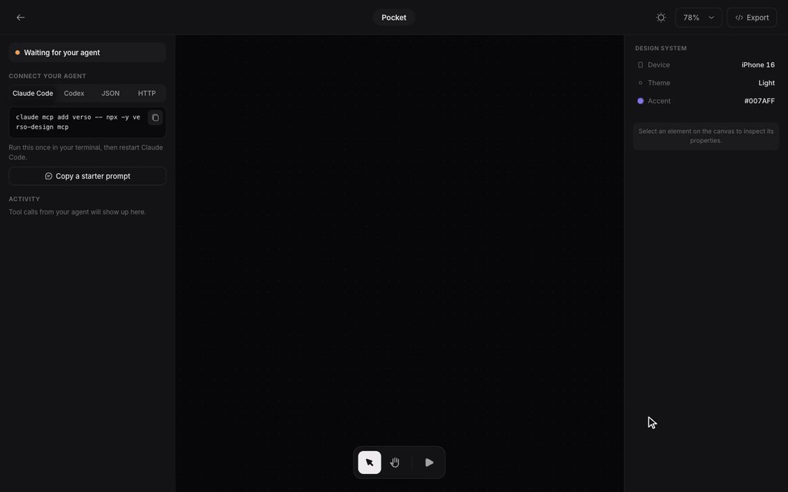
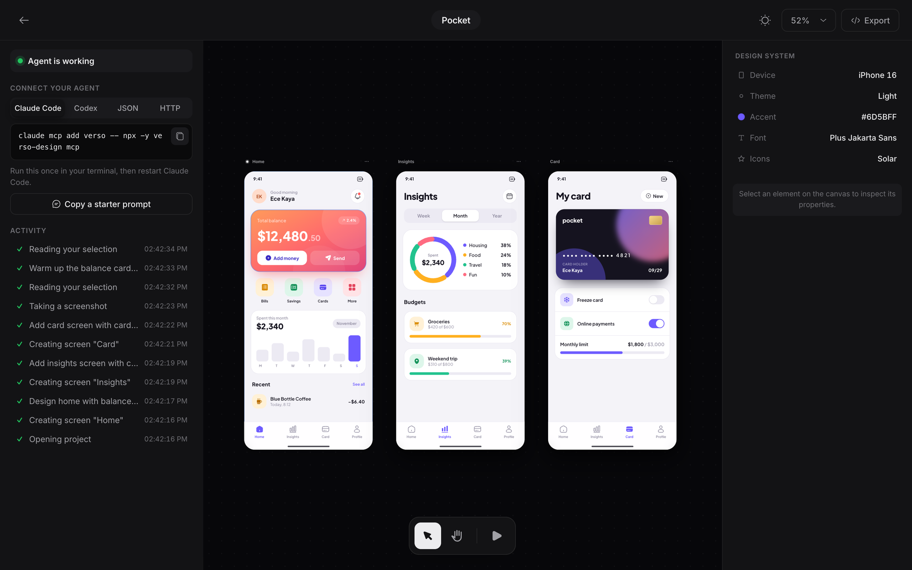

# Verso

A local design canvas for AI agents. Ask Claude Code, Codex, Cursor or any MCP client to design mobile and web screens, and watch them appear in your browser as they are built.



- **Runs on your computer.** No account, no cloud, no database. Projects are plain JSON files in `~/.verso`.
- **Bring your own agent.** Verso has no AI of its own. Your agent does the designing through MCP, on the plan you already pay for.
- **Real screens.** Every screen is HTML + Tailwind CSS v4 inside an iPhone (393×852) or desktop (1440) frame, ready to hand to a coding agent.

## Quick start

You need Node.js 18.17 or newer.

1. Connect Verso to your agent (once):

   ```bash
   claude mcp add verso -- npx -y verso-design mcp
   ```

   Codex:

   ```bash
   codex mcp add verso -- npx -y verso-design mcp
   ```

   Cursor, Claude Desktop, Windsurf, VS Code and other clients take this in their MCP settings:

   ```json
   {
     "mcpServers": {
       "verso": { "command": "npx", "args": ["-y", "verso-design", "mcp"] }
     }
   }
   ```

2. Ask your agent for a design:

   > Design a 3-screen onboarding for a meditation app in Verso.

   Verso starts in the background and opens the canvas in your browser. Screens appear as the agent writes them.

To browse your projects without an agent, run `npx verso-design`. It opens http://localhost:4444.

## What you can do on the canvas



- **Watch and steer.** The left panel shows each tool call the agent makes, live.
- **Point at things.** Click any element, then tell your agent "make the selected button bigger". The agent reads your selection with `get_selection`.
- **Leave notes.** Click an element, type a note, press Enter. Then ask your agent to "apply my Verso notes".
- **Inspect.** Click an element to see its size, spacing, typography and colors.
- **Prototype.** Ask the agent to link screens, then press Play to click through them.
- **Version history.** Every change gets a named version you can restore.
- **Export.** Download PNG or HTML, or copy a prompt that lets a coding agent rebuild the design in Expo, Flutter or SwiftUI.

## How it works

```
Claude Code / Codex / Cursor ──MCP (stdio or HTTP)──▶ Verso server (localhost:4444)
                                                         │  projects in ~/.verso
                                                         ▼
                                       Editor tab in your browser (WebSocket)
                                       renders the screens and runs the design tools
```

`verso mcp` speaks MCP over stdio. If a Verso server is already running it forwards calls to it; otherwise it starts one itself. Design tools run in the editor tab, where the canvas lives, so Verso opens that tab when an agent needs it.

The server also serves MCP over Streamable HTTP at `http://localhost:4444/mcp`:

```bash
claude mcp add --transport http verso http://localhost:4444/mcp
```

## Tools

| Tool | What it does |
|------|--------------|
| `list_projects`, `create_project`, `open_project` | Find, start or open a project (opens the canvas) |
| `get_design_guide` | The design rules: theme tokens, layout, icons, images, quality bar |
| `create_screen`, `switch_screen`, `rename_screen`, `delete_screen`, `list_screens` | Manage screens |
| `write_html`, `get_screen_html` | Write or read a whole screen |
| `get_tree`, `set_text`, `set_class`, `set_style`, `replace_node_html`, `remove_node` | Read the layer tree and make precise edits by `data-ps-id` |
| `get_screenshot` | PNG of a screen, so the agent can check its work |
| `get_design_settings`, `set_design_settings` | Device, theme, accent, font, icons and the project brief |
| `get_selection` | What the user selected and the notes they left |
| `search_images`, `add_image` | Find stock photos, or add the agent's own images |
| `auto_prototype`, `set_links` | Wire screens together for Play mode |

## Images

- `search_images` uses [Openverse](https://openverse.org) by default (openly licensed photos, no key needed).
- For [Unsplash](https://unsplash.com/developers), create a free app and set `UNSPLASH_ACCESS_KEY` in the environment of your MCP server:

  ```bash
  claude mcp add verso -e UNSPLASH_ACCESS_KEY=your_key -- npx -y verso-design mcp
  ```

- `add_image` copies a local file, a URL or a data URI into the project, so images your agent generated (or files you gave it) can be used in designs.

## Options

| Flag / variable | Default | |
|---|---|---|
| `--port`, `VERSO_PORT` | `4444` | Port for the canvas and the HTTP MCP endpoint |
| `--data`, `VERSO_HOME` | `~/.verso` | Where projects and images are stored |
| `--no-open` | | Do not open the browser on start |
| `VERSO_NO_OPEN=1` | | Never open the browser automatically |
| `UNSPLASH_ACCESS_KEY` | | Use Unsplash for `search_images` |

If you change the port, pass the same `--port` to `verso mcp`.

## Privacy and security

- The server listens on `127.0.0.1` only and rejects requests whose `Host` or `Origin` is not localhost, so websites you visit cannot read or change your projects.
- Nothing is sent anywhere except what your designs load: Tailwind, Iconify and Google Fonts from their CDNs, photo searches to Openverse or Unsplash, and images you embed.
- Screens are HTML written by your agent and run in the editor. Only use agents you trust.

## Development

```bash
git clone https://github.com/devsemih/verso-design.git
cd verso-design
npm install
npm start            # http://localhost:4444
```

Point your agent at your checkout:

```bash
claude mcp add verso-dev -- node /path/to/verso-design/bin/verso.js mcp
```

`scripts/make-demo.sh` records the demo above with headless Chrome and rebuilds `docs/demo.gif` and `docs/screenshot.png`. It uses a throwaway project, so nothing from your machine ends up in the images. It needs Google Chrome, ffmpeg and ImageMagick.

```
bin/verso.js        CLI: start the canvas, or run the stdio MCP server
server/index.js     HTTP server, API, static files, localhost guard
server/tools.js     MCP tool definitions and implementations
server/bridge.js    WebSocket bridge to the editor tabs
server/store.js     File-based project storage
server/images.js    Photo search and image import
server/guide.js     Design guide and MCP instructions
public/             Editor, project list, renderer and preview pages
scripts/            Demo recording for the README
```

## License

MIT
